<p align="center">
  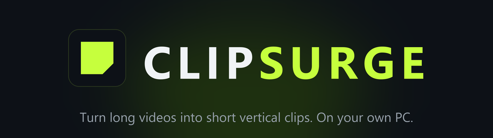
</p>

<p align="center">
  Clipsurge finds the best moments in long videos, crops them to 9:16, adds captions and exports them, all on your own computer.
</p>

<p align="center">
  <a href="#install-one-powershell-command"><b>Install</b></a> &nbsp;·&nbsp;
  <a href="docs/USAGE.md"><b>How to use</b></a> &nbsp;·&nbsp;
  <a href="docs/INSTALL.md"><b>Install guide</b></a> &nbsp;·&nbsp;
  <a href="CREDITS.md"><b>Credits</b></a>
</p>

<p align="center">
  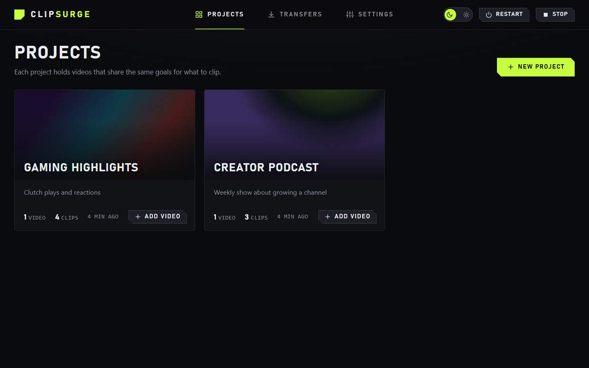
</p>

> **Copyright (c) 2026 unlimitedera. All Rights Reserved.** Clipsurge is proprietary software. You may look at the source code on GitHub, but you may not use, copy, modify, share or sell it without written permission from the author. See [LICENSE](LICENSE) and [TERMS.md](TERMS.md).

## Install (one PowerShell command)

Open **PowerShell** and run:

```powershell
irm https://raw.githubusercontent.com/unlimitedera/Clipsurge/main/install.ps1 | iex
```

It installs Python 3.11 and ffmpeg if you do not have them, sets everything up in `%LOCALAPPDATA%\Clipsurge`, adds a Desktop shortcut, and opens Clipsurge in your browser at `http://127.0.0.1:8420`. Run the same command again any time to update. Your projects, videos and keys are kept.

Full guide, options and troubleshooting: [docs/INSTALL.md](docs/INSTALL.md)

## What it does

| | |
|---|---|
| **Find the best moments** | Reads the speech, loudness, on-screen text and YouTube chat spikes. An optional local AI model rates the moments and writes titles. |
| **Projects with goals** | Tell it what to look for ("clutch plays", "funny reactions") and what to skip. Every video in the project follows those goals. |
| **Smart vertical crop** | Webcam on top with gameplay below, centre slice, whole screen with blur, follow a face, **cut to whoever is speaking**, or place the crop yourself. |
| **Captions** | Word by word captions in several styles, in any language, including Arabic and other right to left languages. |
| **Title narration** | A voice reads the clip title at the start, with the title shown on screen if you like. |
| **Manual clipping** | Watch the full video and mark your own clips on a loudness timeline. |
| **Editor** | Timing, crop, captions, sound (noise reduction, voice effects, music with ducking), look (speed, fades, colour). |
| **Upload** | Send clips to YouTube Shorts with a live progress box. |
| **Agents** | Control everything from Hermes, Claude Code or any MCP client. |
| **Private** | Videos, transcripts and clips stay on your computer. |

## Screenshots

| | |
|---|---|
| 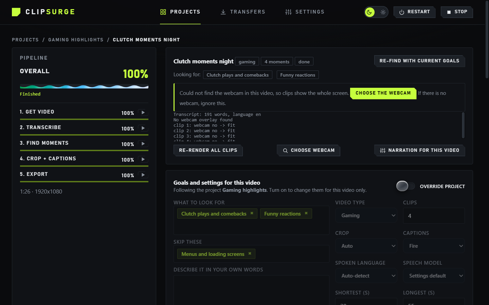 | 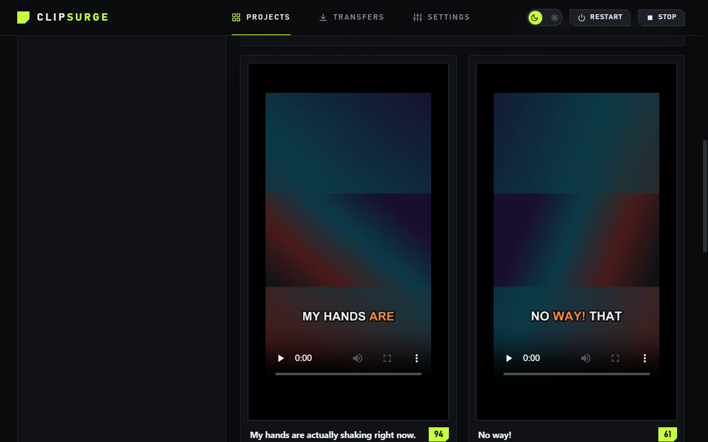 |
| **A video**: pipeline steps with a redo button on each, per video goals, webcam picker | **Clips**: scored moments with captions already burned in |
| 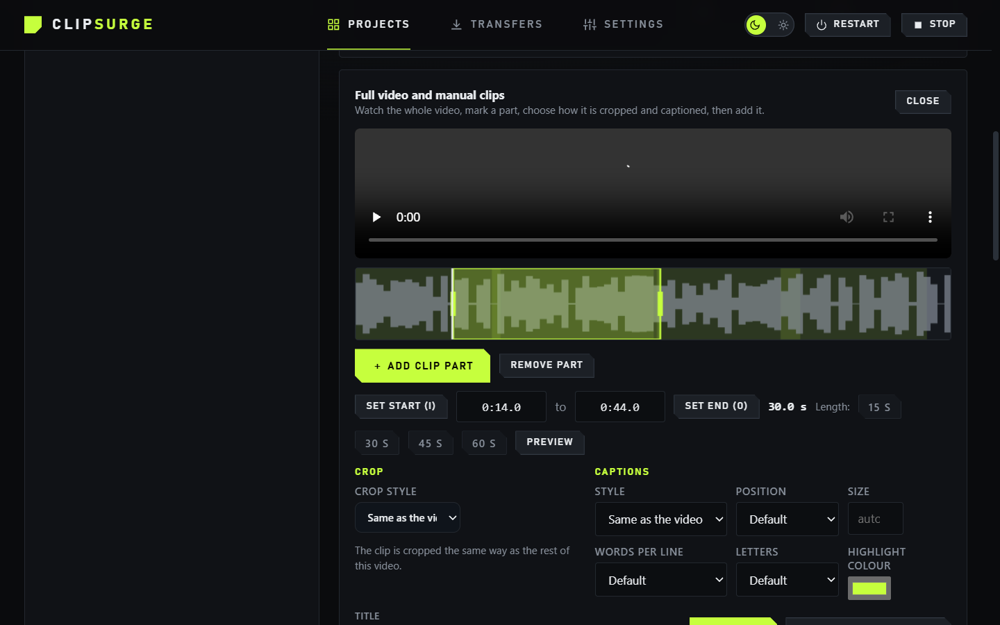 | 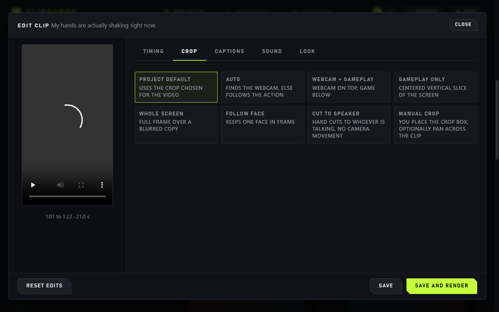 |
| **Manual clipper**: mark parts on the loudness timeline, choose crop and captions | **Clip editor**: crop styles including cut to speaker |
| 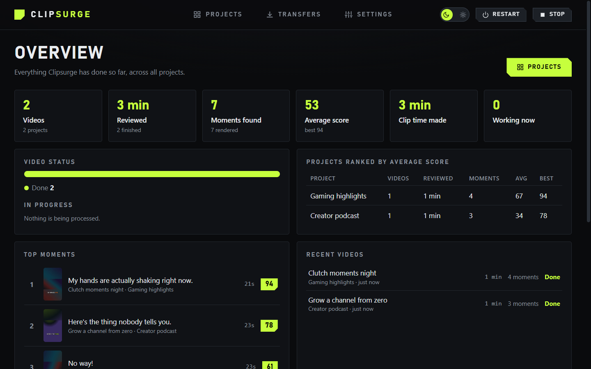 | 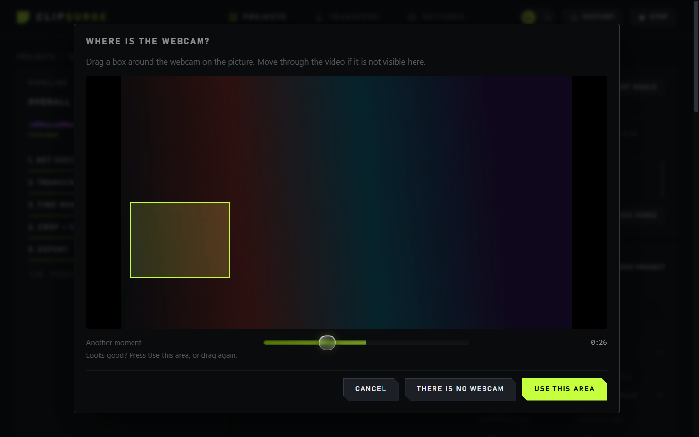 |
| **Overview**: status, minutes reviewed, ranking | **Webcam picker**: drag a box when the webcam is not found |
| 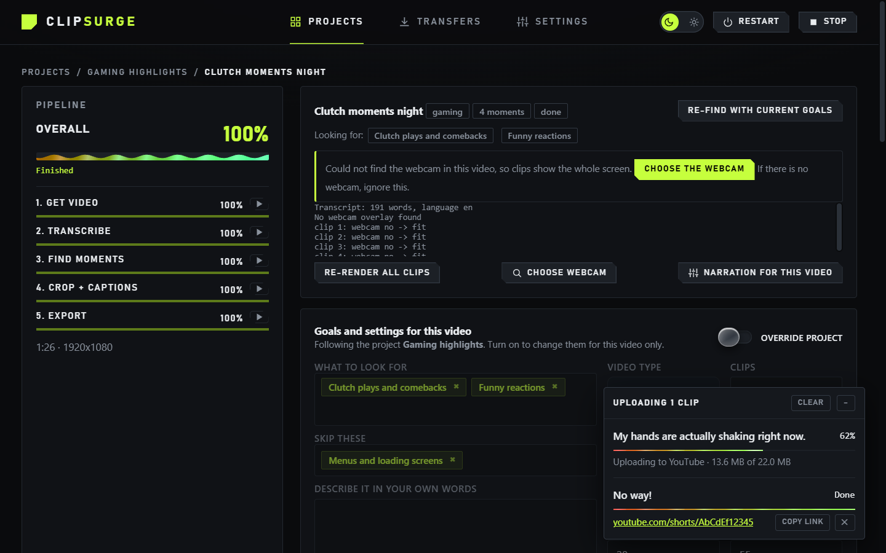 | 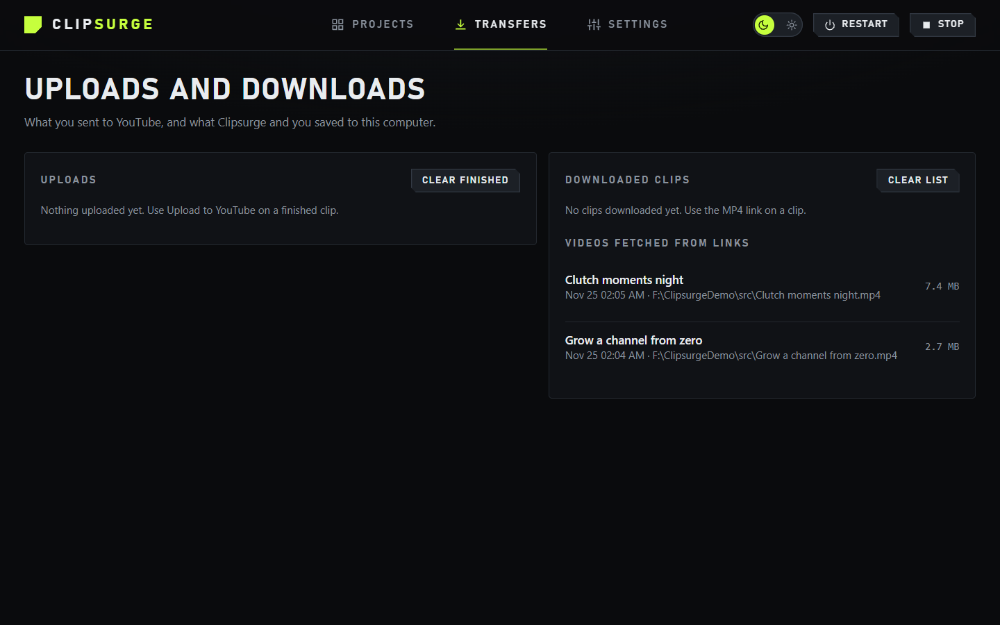 |
| **Upload box**: live progress and the link when done | **Transfers**: uploads and downloads history |
| 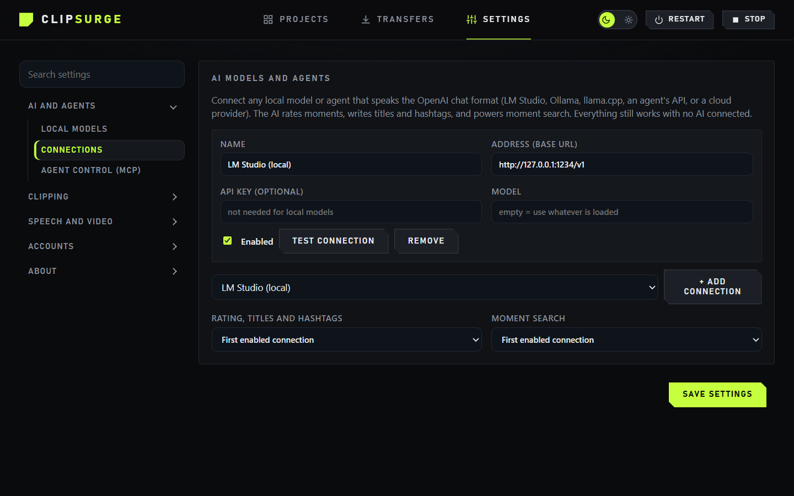 | 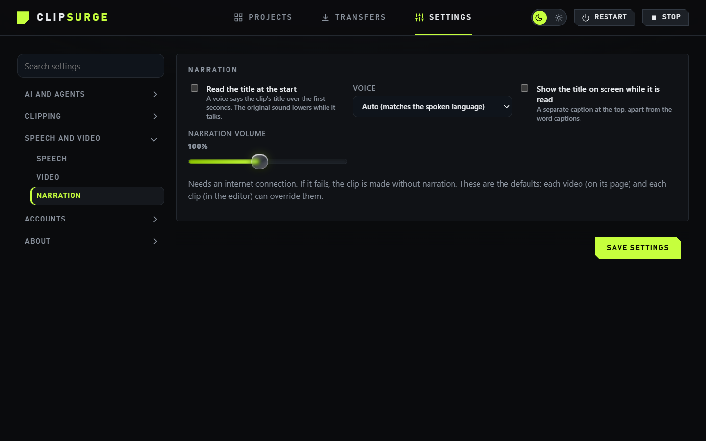 |
| **Settings**: categories with search | **Narration** settings |

The screenshots use demo videos made from synthetic speech. No personal data is shown.

## Quick start

1. **Create a project.** Projects > New project. Pick a video type (Auto, Gaming, Podcast, Tutorial) and add what to look for.
2. **Add videos.** Press **Add video** on the project card. Paste links (YouTube, Twitch and more), pick files from your PC, or upload.
3. **Wait for the pipeline.** Get video, transcribe, find moments, crop and captions, export. Each step shows live progress.
4. **Review the clips.** Open a video, play the clips, edit any of them, delete the ones you do not want.
5. **Upload or download.** Use the MP4 link, or **Upload to YouTube**.

The step by step tutorials are in [docs/USAGE.md](docs/USAGE.md).

## Requirements

- Windows 10 or 11 (64 bit)
- About 6 GB of free disk space for the install, plus space for your videos
- 8 GB RAM or more. A graphics card from NVIDIA makes speech to text several times faster, but it is not required.
- An internet connection to install, to download videos from links, and for narration voices

## Connect an AI model (optional)

Everything works without one. To get smarter ratings, titles and moment search, open **Settings > AI and agents** and connect any OpenAI compatible model: LM Studio, Ollama, llama.cpp (Clipsurge can run one for you), or a cloud provider.

## Control it from an agent

Settings > AI and agents > Agent control (MCP) shows the exact command for Hermes, Claude Code and Claude Desktop. Agents can create projects, add videos, check progress, search moments, add clips and upload.

## Credits

Clipsurge is built on many open source projects: yt-dlp, FFmpeg, faster-whisper, OpenCV, YuNet, RapidOCR, FastAPI, llama.cpp and more. Full list with licenses: [CREDITS.md](CREDITS.md). It is also in the app under **Settings > About > Credits**.

## Author

Created by **unlimitedera**.

## License

Copyright (c) 2026 unlimitedera. All Rights Reserved. See [LICENSE](LICENSE). To ask for permission to use Clipsurge, open an issue on this repository or contact the author through GitHub.
