# How to use Clipsurge

A walk through every part of the app. Open Clipsurge from the Desktop shortcut (or `start.bat`) and follow along.

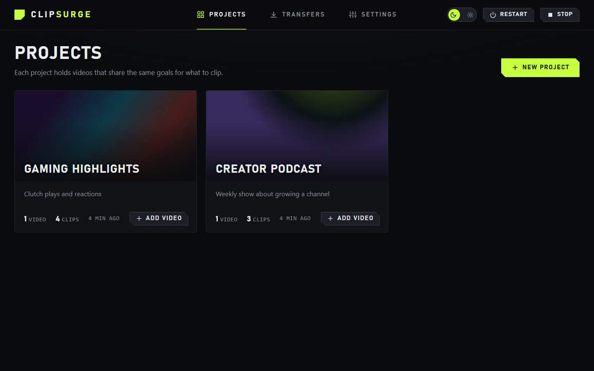

## 1. Projects and goals

A **project** is a group of videos that share the same goals. Make one for each show or channel.

1. Projects > **New project**.
2. Give it a name and pick the **video type**:
   - **Auto** guesses from the video.
   - **Gaming** reads on-screen text such as KILL and VICTORY, and keeps the webcam on top.
   - **Podcast** and **Tutorial** focus on speech and clear explanations.
3. Under **What to look for**, add short phrases ("clutch plays", "surprising stories"). Under **Skip these**, add what you never want ("sponsor reads", "menus").
4. In **Describe it in your own words**, write anything the AI should know about your style and audience.

You can change all of this later: open the project and choose **Goals and settings**. A **Storage** card there shows how much space the project uses, with a folder tree. Click any name to open it in Explorer.

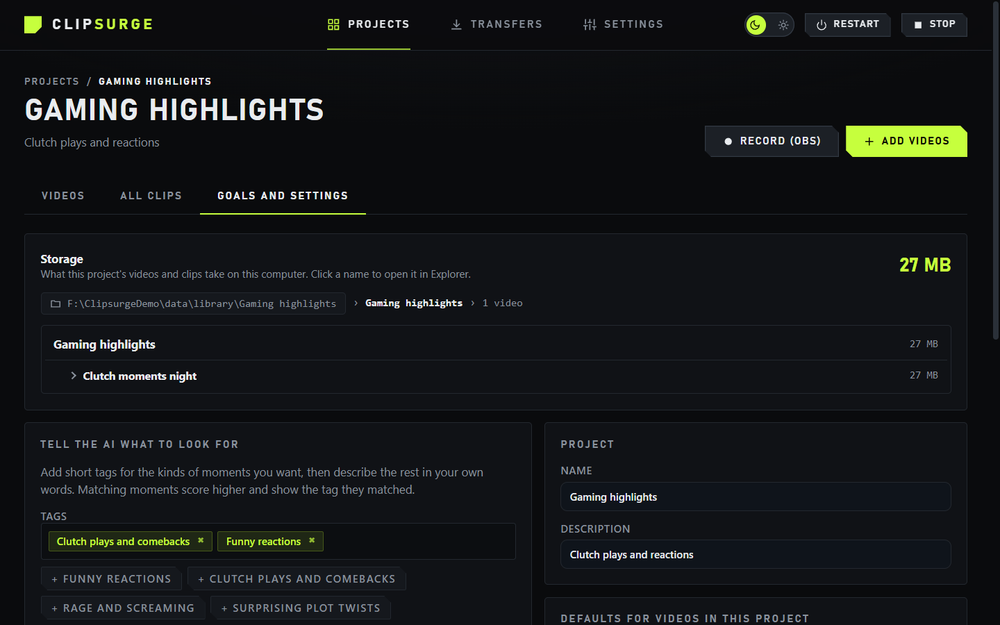

## 2. Add videos

Press **Add video** on a project card (or **Add videos** inside the project). You can:

- paste links, one per line (YouTube, Twitch and many other sites),
- **Browse this PC** to pick files already on your computer,
- **Upload files** from anywhere,
- record from OBS with **Record (OBS)** (turn on the WebSocket server in OBS first, see Settings > Accounts > OBS).

## 3. Watch the pipeline

Open the video. The left side shows five steps with live progress:

1. **Get video**: downloads it.
2. **Transcribe**: turns speech into words with timing.
3. **Find moments**: scores every part of the video and picks the best.
4. **Crop + captions**: makes each vertical clip.
5. **Export**: writes the timeline files (.otio and .edl).

Each finished step has a small **play** button: **redo just that step**. For example, redo *Crop + captions* after you change the crop, without downloading or transcribing again. The dialog asks whether to redo the steps after it too.

If a step is quiet for a while, Clipsurge says what it is waiting for. A **Retry** button appears when it may be stuck.

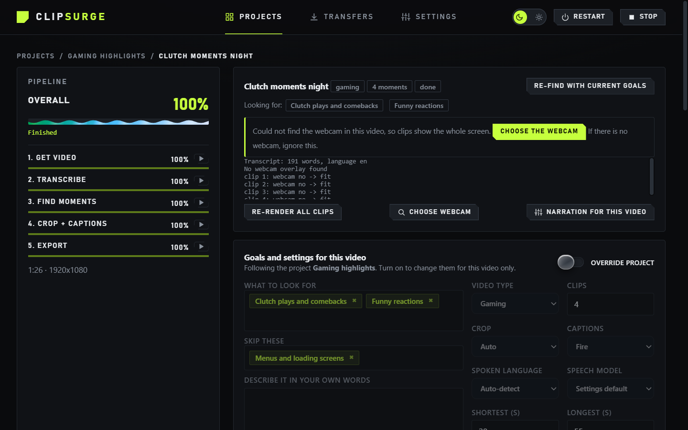

## 4. Review the clips

Each clip has a score, a title and a preview. Scores come from loudness, speech, keywords, your goals and (if connected) the AI.

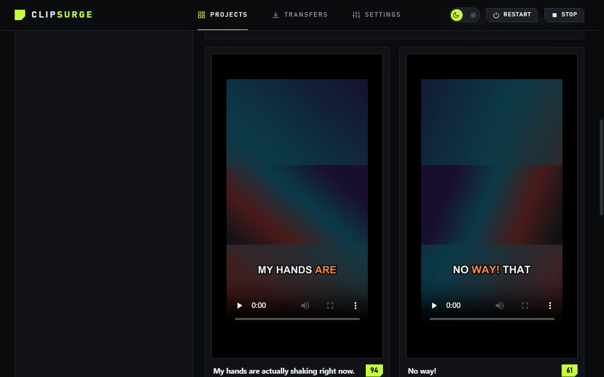

On every clip you can **Open**, **Edit**, delete, download the MP4, SRT or ASS captions, or **Upload to YouTube**.

## 5. The clip editor

Press **Edit** on a clip. Tabs:

- **Timing**: drag the handles on the loudness map, with word accurate cuts.
- **Crop**: choose how the 16:9 video becomes 9:16.

| Crop style | Use it for |
|---|---|
| Auto | Finds the webcam, else follows the action |
| Webcam + gameplay | Webcam on top, game below |
| Gameplay only | Centre slice of the screen |
| Whole screen | Full frame over a blurred copy |
| Follow face | Keeps one face in frame |
| **Cut to speaker** | Hard cuts to whoever is talking, no camera movement. Good for podcasts with two or more people |
| Manual crop | You place the box, and can pan to a second position |

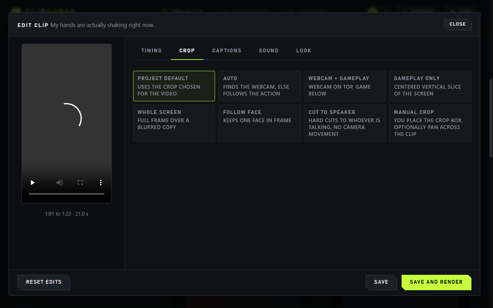

- **Captions**: style (Pop, Clean, Fire), position, size, colour, words per line, all caps, and **Fix wording** to correct any misheard word.
- **Sound**: volume, noise reduction, even out the voice, voice effects, bass and treble, background music that lowers while someone speaks, and **Title narration**.
- **Look**: speed, fades, brightness, contrast, saturation.

Press **Save** to keep your changes or **Save and render** to make the clip again.

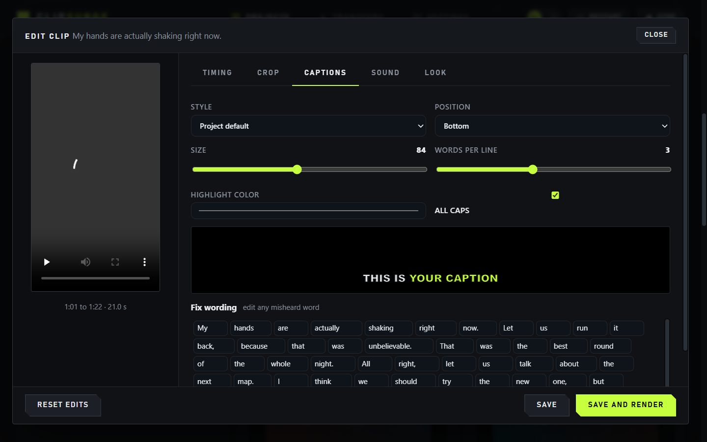

## 6. Cut to speaker

For podcasts and interviews, set the crop to **Cut to speaker**. Clipsurge finds each face, watches which mouth moves while the transcript says someone is talking, and cuts to that person. It will not flicker: a shot lasts at least 1.6 seconds. Paintings and posters with faces are ignored. In **Auto**, it is chosen for you when two or more people are on screen.

Limits: it follows lip movement, so someone laughing while another person talks can win for a moment. People at the far edge of a wide shot are small, so their crop is softer.

## 7. The webcam

In Gaming mode Clipsurge looks for your webcam overlay and puts it on top of the clip.

If it cannot find it, the video page shows a note with **Choose the webcam**. You can also press **Choose webcam** at any time. Drag a box around the webcam on the picture (use the slider to look at another moment), then **Use this area**. **There is no webcam** stops the prompt. **Detect automatically again** drops your box. Your box is kept when you redo steps.

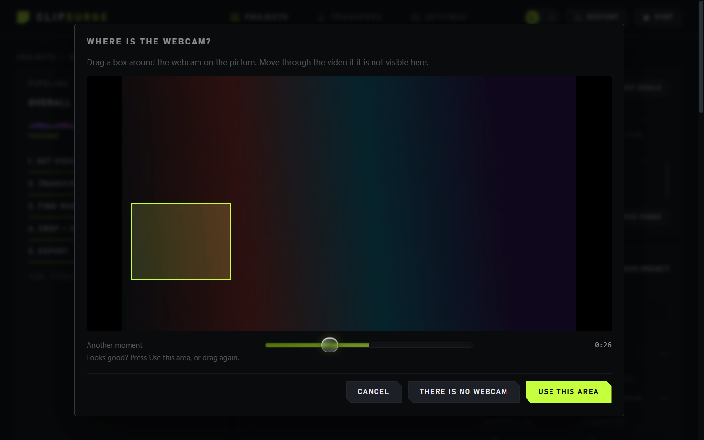

## 8. Manual clipping

Want a part the AI did not pick? On a video page open **Full video and manual clips**.

1. Play or scrub the video. **A click on the timeline only jumps** to that moment.
2. Press **Add clip part** to mark 30 seconds at the playhead.
3. Drag the part to move it, or drag its ends to resize. Type exact times, press **Set start (I)** and **Set end (O)**, or use the 15, 30, 45 and 60 second buttons. **Preview** plays only the part.
4. Choose the crop style (including **Manual crop**: drag the green box right on the video and use the zoom slider) and caption options.
5. Give it a title and press **Add clip**, or **Add and open editor** to fine tune it.

Keys: **I** start, **O** end, **Space** play or pause, **left and right arrows** move 5 seconds.

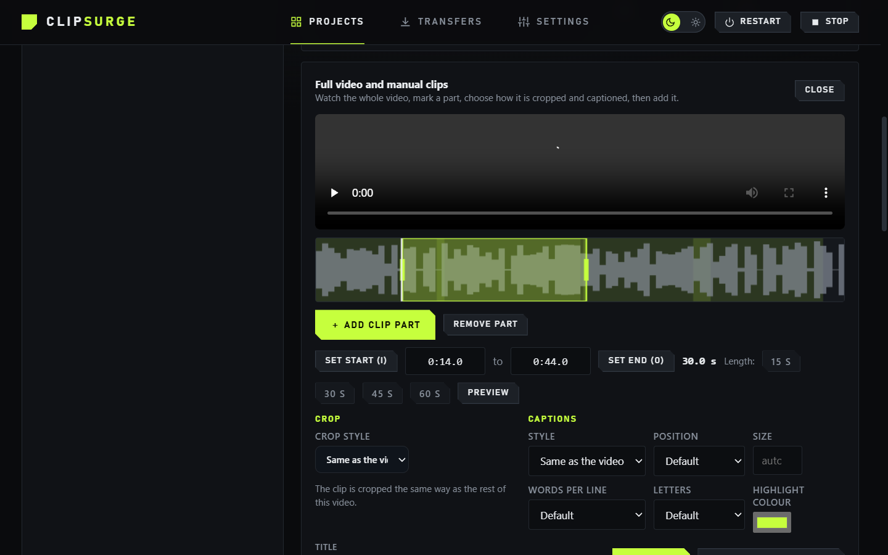

## 9. Title narration

A voice reads the clip title at the start, and the original sound lowers while it talks.

- **Settings > Speech and video > Narration**: the default for everything. Choose the voice, set the volume with the slider, and optionally **show the title on screen** while it is read, as a separate caption at the top.
- **Narration for this video** (button on the video page): change it for one video.
- **Editor > Sound > Title narration**: change it for one clip, including the words to read.

The most specific setting wins: clip, then video, then Settings. The voice is picked from the spoken language unless you choose one. It needs an internet connection; if it fails, the clip is made without narration.

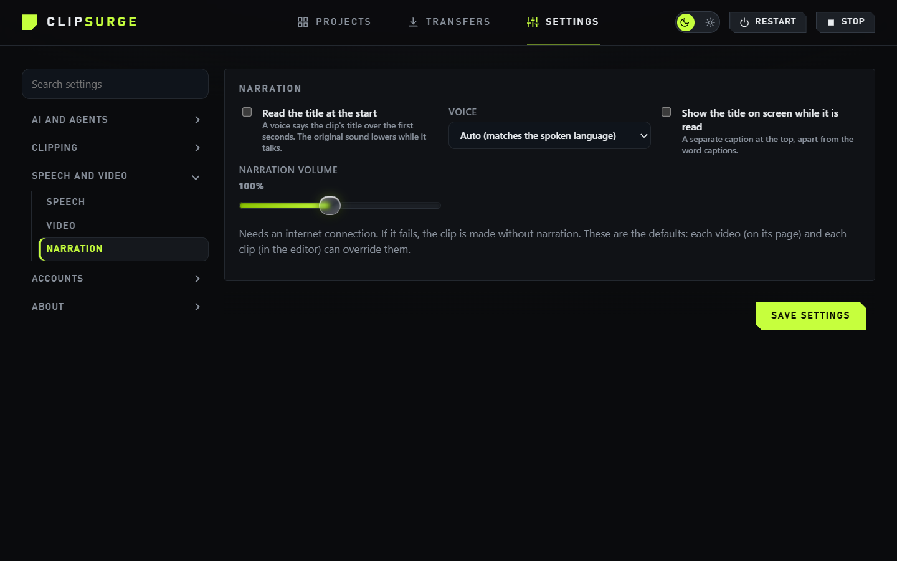

## 10. Override the project for one video

Each video page has **Goals and settings for this video** with an **Override project** switch. Turn it on and the fields unlock: this video uses its own goals, type, clip count, lengths, crop, captions, language and speech model. Turn it off and the video follows the project again. Clips already made stay until you redo *Find moments* or *Crop + captions*.

## 11. Upload to YouTube

One time setup (about 5 minutes), in **Settings > Accounts > YouTube**:

1. **Get your Google key**: press **Show me how**. It links to each page: create a project, turn on the YouTube Data API, set up the consent screen and add yourself as a test user, create an OAuth client of type **Desktop app**, and download the JSON file.
2. **Add the key**: drop the file onto the box (or paste the client id and secret).
3. **Sign in with Google**: a Google page opens, approve once.

Then press **Upload to YouTube** on any clip. A box opens at the bottom right with live progress. When it finishes, it shows the link with **Copy link**. Uploads are private by default; change **YouTube uploads are** in the same settings page.

If Google says "Access blocked: error 403 access_denied", add your Google email under **Test users** (Google Cloud > Auth > Audience) and try again.

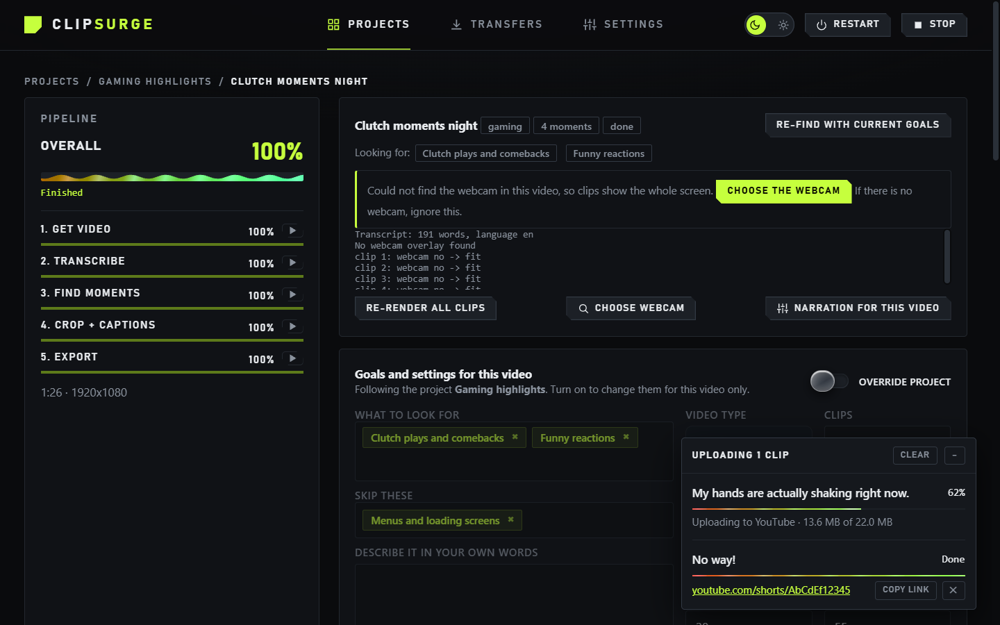

## 11b. Upload to TikTok

One time setup, in **Settings > Accounts > TikTok** (about 10 minutes, free):

1. Log in at developers.tiktok.com, open **Manage apps** and create an app of type **Desktop**.
2. Add the products **Login Kit** and **Content Posting API**, and turn on **Direct Post**.
3. In Login Kit add the redirect address `http://127.0.0.1:*/callback/` (there is a Copy button).
4. Paste the **Client key** and **Client secret** in Clipsurge and press **Save key**.
5. Press **Connect TikTok** and sign in.

Then press **Upload** on any clip and pick **TikTok**. The caption is the title plus up to 5 hashtags.

Important: until TikTok audits your app, every post is **private** (only you see it), the TikTok account must be private, and at most 5 accounts a day can post through one app. You can make a post public inside TikTok afterwards, or apply for TikTok's audit to lift the limit. TikTok allows about 15 posts per account per day.

## 11c. Platform rules and risk warnings

**Settings > Accounts > Platform rules** (also the *Platform rules* link in the footer) lists, for YouTube, TikTok and the sites you download from: the terms and copyright rules, the limits, and the official links. The same text is in [PLATFORMS.md](PLATFORMS.md).

- The first time you post to a platform, Clipsurge shows its rules and asks you to confirm once.
- Before every post it counts your posts to that platform in the last 24 hours. After **6 on YouTube** or **5 on TikTok** it shows a warning, and you must tick *I understand and proceed at my own risk*. After **15 on YouTube** or **12 on TikTok** the warning is stronger.
- Those numbers are Clipsurge's own cautious defaults. YouTube does not publish what counts as automated or spam behavior, so nobody can tell you the exact line. Space posts out and make each clip different.

## 12. Transfers and overview

- **Transfers** tab: every upload (with Open and Copy link), the clips you downloaded, and the videos Clipsurge fetched from links.
- Click the **Clipsurge logo** for the **Overview**: how many videos, minutes reviewed, moments found, average and best score, a status bar, the top 10 moments, and projects ranked by average score.

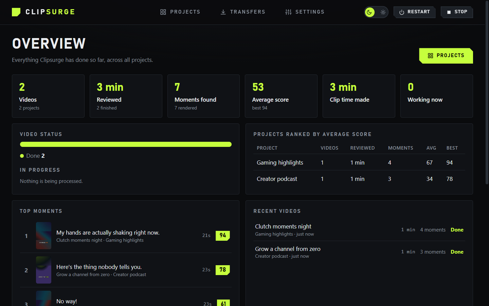

## 13. Settings

Categories on the left, settings on the right, with **search** at the top.

| Category | Contains |
|---|---|
| AI and agents | Local models, connections, agent control (MCP) |
| Clipping | Defaults for new clips, features (AI rating, on-screen text, chat spikes, webcam finding, loudness, captions in the spoken language only) |
| Speech and video | Speech model, language, device, encoder, loudness target, caption size, download quality, narration |
| Accounts | YouTube, OBS |
| About | About, license, terms, credits |

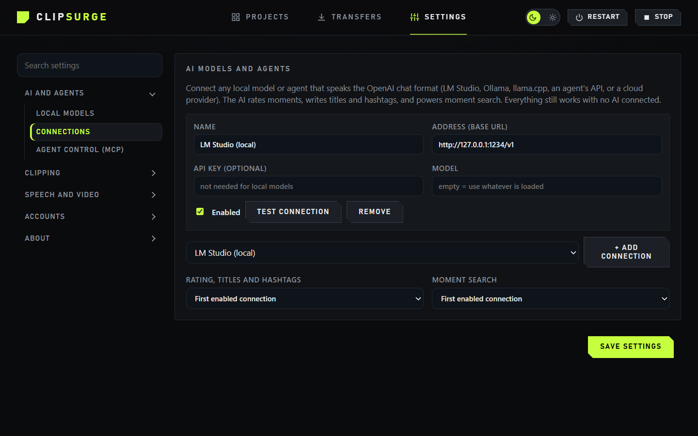

The top bar shows graphics memory, disk used by Clipsurge, and system memory. **Unload model** appears when Clipsurge itself loaded a language model. **Stop** shuts the service down, **Restart** restarts it. Videos in progress are paused and can be resumed.

## 14. Connect an AI model (optional)

Settings > AI and agents:

- **Connections**: add LM Studio, Ollama, llama.cpp, an agent's API or a cloud provider. Press **Test connection**.
- **Local models**: Clipsurge can download a model and run it for you with llama.cpp. It checks your graphics memory first and picks settings that fit.
- Choose which connection rates moments and which one handles search.

## 15. Control Clipsurge from an agent (MCP)

Settings > AI and agents > Agent control (MCP) shows ready to paste commands for Hermes, Claude Code and Claude Desktop. An agent can list and create projects, add videos, check progress, search moments by describing them, add clips and upload.

## 16. Bad language filter

Turn on **Hide curse words** and curses are hidden in two places:

- **Captions** show the first letter and stars: `F***`, `S***`. The SRT file does the same.
- **Title narration**: the narrator says only the first part of the word ("fu...", "sh...") and the on-screen title shows `f***`.

Where to set it, most specific wins: **Editor > Captions > Bad language** (one clip, also in the manual clipper), **Goals and settings for this video** (one video, with Override on), **Goals and settings** of the project, then **Settings > Clipping > Bad language** for everything. Each one can say Hide, Show, or follow the level above. You can add your own words in Settings.

It matches whole words in English, Spanish, French, German, Turkish and Arabic, so "class" and "assume" are left alone. It does not change the sound of the original video: a curse in the clip's own audio is still heard. Names that look like a curse (a person called Dick) are hidden too. Redo *Crop + captions* to apply it to clips you already made.

## 17. Performance and trending tags

**Overview > Performance of your uploads** shows views, likes and comments for every clip you uploaded from Clipsurge, ranks them, and explains what the best ones have in common: clip length, crop, title style, tags, when you posted. It needs at least 4 uploads with numbers before it states patterns, and says how sure it is. Few videos can be luck, so read it as hints, not rules.

- Uploads set to **Private** hide their numbers. Press **Allow Clipsurge to read stats** once (Google asks again; Clipsurge only reads counts). Public and unlisted uploads work without it.
- **Learn from my results** (Settings > Accounts > YouTube) lets Clipsurge use your best clips as a reference when it picks moments and writes titles.
- **Trending tags**: type a topic to see tags used by two or more different channels on popular shorts about it.
- **Suggest tags when uploading** opens a window with tags from the clip, from your best videos and from trending videos on the topic. Remove any you do not want. The first three become hashtags in the description.

Nothing can promise a video goes viral. Clipsurge only suggests tags that fit the topic.

## 18. SurgeAI

On any project page and any video page there is a **SurgeAI** button at the bottom left. It opens a chat panel with SurgeAI, a little animated bot who talks to the model you connected in Settings > AI and agents (LM Studio, Ollama, or the model Clipsurge runs for you).

- SurgeAI reacts while you chat: it waves hello, leans in while you type, thinks (with a thought bubble) while the model works, talks while the answer streams in, then celebrates. If the model cannot be reached, it looks sad.
- Clipsurge shares a short briefing with your model: the goals, the clips with their scores and what is said in them, the start of the transcript, your upload results and the trending tags it already looked up. Nothing leaves your computer unless your model is a cloud one.
- On a video page, **Focus on** lets you pick one clip, for example "why did clip 4 score low?".
- Try the suggestions: better titles, tags for this video, how to raise low scores, which moments you may have missed, ideas for the next clips.
- Click a #hashtag in an answer to copy it. **Copy** copies a whole answer. The chat is kept per project and video; **Clear** erases it.
- A small model gives weaker answers. A bigger one reasons better about scores. Answers can be wrong, and nobody can promise a video will go viral.

## 19. Updates

When a new version is on GitHub, an **Update** button appears in the top bar. Click it to see what changed, then **Update now**. Clipsurge downloads the new files, checks them, installs them and restarts, then the page reloads on its own. Your projects, videos, clips, settings and YouTube key are not touched. If a video is processing, wait for it to finish first.

**Settings > About** shows your version and has **Check for updates** and a switch to stop the prompt. The check only asks GitHub which version is newest. Nothing about you or your videos is sent.

## Tips

- Gaming videos: keep **Read on-screen text** on. It makes KILL, VICTORY and ACE moments score higher. It is slow on long videos if a model also uses your graphics card.
- Arabic and other languages: set the spoken language in the project, and use the **large-v3** speech model for the best accuracy.
- Short on disk space: videos are the big part. Delete a video from its project to remove its files, or check the **Storage** card in the project.
- Dark or light theme: the switch at the top right.
